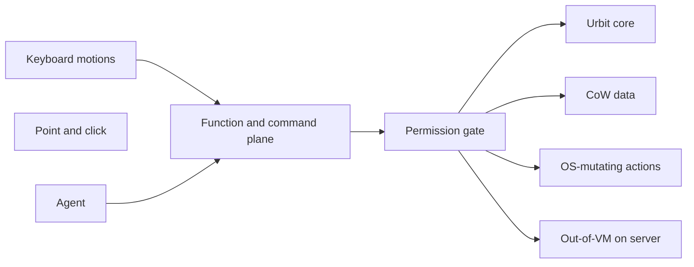
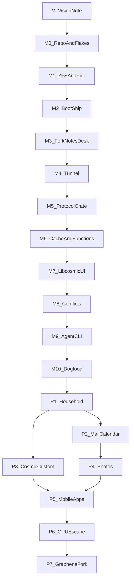

# Locus

*Initial conception: 2026-07-11 | Rewritten: 2026-08-12 | Brought into this repo: 2026-09-08*

Household computing platform. Older vault notes used the working title **Digital Workspace System**.

**Where we are (2026-09-08):** notes spike (M0–M3, M5–M9) is treated as done on the localhost bring-up VM. M4 (off-LAN tunnel) is deferred until it is needed. P1 is live-proved on that VM (`./scripts/server-vm.sh p1`) — see [locus.md](locus.md). P2 Gall mail/calendar stores are [mail.md](mail.md) (`./scripts/server-vm.sh p2`). P3 first slice is a NixOS COSMIC client module (`cosmic-comp`, autotile, declared Firefox) — [cosmic.md](cosmic.md) (`./scripts/cosmic-p3.sh`). **P4** (photo catalog + contacts, ZFS bytes, thumb cache) is in-repo — [photos.md](photos.md). Automated bar: `./scripts/plan-check.sh`. Live OCC: `./scripts/server-vm.sh p4`. Do not start P5–P7.

---

## One sentence

A household runs a home server as its cloud: as much of the backend as possible lives in Urbit; customized COSMIC (still the COSMIC compositor) NixOS clients and a Graphene/AOSP mobile fork talk to that same server, including over the internet; only apps too complex to port (Steam, 3D, other demanding software) run on the server outside the Urbit VM; simultaneous edits reconcile gracefully even when sync is delayed; ZFS sits under what Urbit does not hold.

---

## The problem

- **Cloud convenience without ownership.** Google/M365 give shared efficiency (one GPU, one disk, many users) and revoke it whenever they want. Subscriptions, dark patterns, tracking, remote kill.
- **Homelab ownership without cloud economics.** Today a home server is a pile of containers. Clients are still fat laptops. Family members each need local compute they barely use.
- **Agents bolted onto GUIs.** Office formats and click-only apps force agents to scrape. The document (and more generally the **command**) should be the API.
- **Slow, unreproducible software.** Web stacks, drifting machines, no rollback. Anything that is not instant needs a reason.

---

## The bet

**Chromebook split, native stack.** Desktop clients are fast NixOS machines running a **thoroughly customized COSMIC desktop that still uses the COSMIC compositor** (libcosmic / iced / Rust): render UI, cache, sync, keyboard. Mobile clients are a **GrapheneOS/AOSP fork** with similarly themed but different apps against the **same server**. The server holds canonical data, identity, GPU, and bulk storage. Not everyone in the family needs the GPU at once — that is the cloud’s utilization argument, kept inside the house. Remote access over the internet is required, not optional.

**Urbit is the default backend.** Identity, namespace, policy, documents, notes, agent tools, and as much other OS function as will fit belong *inside* Urbit — not merely “inspired by” it. The event log / Clay match “deterministic, owned, append-only.”

**Escape hatches are a porting concession, not a second OS.** Steam games, 3D apps, and other demanding software are often too complex to port into Urbit or rewrite in Hoon. Those run on the **main home server**, bare metal or in containers, **not in the Urbit VM**. They still obey the same principles as far as the host allows (sovereignty, permissions, instant where it matters, declarative install via Nix) and **interop** with the Urbit core: launch and grant via the command/permission plane, share identity, exchange files/state where it is reasonable. The client still renders; the heavy process still lives on the server so the household can share a GPU.

---

## Non-negotiable principles

1. **Sovereignty.** Canonical compute and data live on hardware you own. A tunnel (Cloudflare or otherwise) is a pipe for reachability, never the store or the identity provider.
2. **Household cloud economics.** Share storage, GPU, and other scarce hardware on the server. Clients stay thin.
3. **Instant by default.** Cache-first. Network fills holes; it does not gate first paint. If something is not instant, the design must justify it.
4. **Existing open source.** NixOS, Disko, COSMIC compositor + libcosmic/iced, Rust, Urbit, GrapheneOS/AOSP, git, Markdown/LaTeX, ZFS — compose, don’t reinvent.
5. **Declarative and reproducible.** A machine is a function of its flake. Atomic upgrades, rollbacks, no config drift. NixOS is Group Policy that actually works.
6. **Text/function first.** Named commands and functions are the real interface. Keyboard motions/shortcuts and point-and-click are both skins on that plane. Agents call the same functions.
7. **Keyboard-efficient UI on a customized COSMIC.** Tiling-WM and modal-editor density inside COSMIC (customized thoroughly; compositor stays cosmic-comp) — not a ribbon OS with a terminal tucked in the back, and not a separate TWM.
8. **Agent-capable, not agent-trusted.** An agent should be able to do almost everything a human can. It must not be able to *unrecoverably* destroy data or silently bork the OS.
9. **Correctness over cleverness.** Stable, boring, recoverable. CoW and approval gates beat “the agent is careful.”
10. **Urbit-default, host-side only when you must.** If it can live in Urbit, it does. Escape hatches are for software that cannot reasonably be ported or rewritten in Hoon — not a general “fast path” around Urbit.
11. **Remote access is required.** The same server must be usable from outside the house. Cloudflare Tunnel is an acceptable mechanism; the data still lives at home.
12. **Simultaneous edits are first-class.** Multiple people (or one person on two devices) may edit the same thing. Sync delay, including over a tunnel, must not cause silent loss. Conflicts reconcile gracefully — keep both / merge / explicit choice — never last-write-wins without a trace.
13. **ZFS under what Urbit does not hold.** Urbit keeps its own persistence for what runs in the VM. The box’s base storage is ZFS, **provisioned with Disko** (snapshots, send/recv, datasets for escape-hatch data and anything else outside Urbit).

---

## Escape hatches

The default is **not** “Urbit for documents, Linux for everything else.” The default is **Urbit for the backend.**

An escape hatch is a demanding app (Steam games, 3D tools, similar) that is too complex to port into Urbit or rewrite in Hoon. It runs on the **same home server**, **bare metal or in a container**, **outside the Urbit VM**.

It is still in the system:

- Installed/declared with the rest of the machine (Nix) where possible
- Launched and permissioned through the same command plane
- Sharing household GPU/storage like any other server-side workload
- Interoperating with Urbit identity, files, and agents as far as the app allows

The thin client still does not host the heavy process; it renders, caches, and inputs. The **browser is not an escape hatch and not an Urbit app** — it is ordinary client software.

---

## What lives where

Rule: **if it is workspace state or an agent should read/write it as data, it belongs in Urbit.** If it is a local renderer or an unportable demanding binary, it does not.

**In Urbit (backend):**

- Identity, namespace, policy, grants, audit
- Notes, Markdown workspace tool, LaTeX typesetter
- Mail, calendar, contacts, household messaging — the stores and the logic. A thin host-side *bridge* (SMTP/IMAP to the rest of the internet) is allowed; that bridge is not the mailer.
- Photo/media **library**: albums, tags, search, sharing, permissions, agent queries. **Bytes** of large media sit on **ZFS**; Urbit holds the catalog and capabilities.
- Agent workers

**On the client (desktop COSMIC / mobile fork):**

- Browser (and its profiles). Declare and permission it; do not port it into Urbit.
- Compositor, windowing, keyboard shell, cache, UI renderers (including WYSIWYG over Urbit documents)
- Touch-native mobile skins of the same Urbit-backed apps

**On the server, outside the Urbit VM:**

- Steam, 3D, other demanding apps that will not be rewritten in Hoon
- Protocol/media edges that must speak the outside world at speed (mail relay, transcode) — bridges, not product apps

---

## Operator model

The function plane is primary. Human and agent are both clients of it.

- **One plane.** Every meaningful action is a named function (create note, move window, search, rebuild system, run a generator). Humans bind keys or clicks to those functions. Agents call them directly. No parallel “agent API” that drifts from the UI.
- **Point-and-click is allowed** as a skin, not as the source of truth. If you cannot do it from a command, an agent cannot do it either — and vice versa, except where permissions differ.
- **Permissions are about blast radius, not capability theater.**
  - Default: agent ≈ human for ordinary work (read/write notes, organize files, query data, draft documents).
  - **CoW / snapshot fence:** delete, overwrite, and “empty trash” do not destroy generations (Urbit history where the data is in Urbit; ZFS snapshots for the rest). Unrecoverable destruction is not a permission the agent gets.
  - **OS-bork fence:** flake changes, bootloader, disk-destroying ops, identity/key operations require explicit human approval (and remain roll-backable via Nix generations).
- **Documents stay agent-native.** Two tools: a Markdown workspace writer (most documents) and a LaTeX typesetter (layout-heavy / scientific). Plain text backends. WYSIWYG is a human renderer on top. The document is still an API. The new piece is that *the whole OS command plane* is that API, not only files.

This replaces the July 2026 line “agent is primary, GUI is secondary.”

---

## System shape

**Server (the household cloud)**

- **Urbit VM:** default backend — identity, namespace, policy, notes/office, mail, calendar/contacts, photo/media *library* (catalog, not necessarily the bytes), agents, and the rest of the workspace.
- **Outside the Urbit VM (same machine):** escape-hatch processes — Steam, 3D, other demanding apps — bare metal or containers. Not a parallel cloud; a host-side runtime for what Hoon cannot reasonably take.
- Interop: those processes are scheduled, identified, and permissioned through the Urbit/command plane as much as possible (launch, GPU share, file exchange, session teardown).
- Workspace state lives on the server. Clients cache aggressively. Concurrent edits from several devices (including delayed tunnel sync) **merge or surface a choice** — they do not silently clobber.

**Desktop client (customized COSMIC)**

- NixOS flake: locked, atomic, roll-backable.
- Thoroughly customized COSMIC desktop; **still the COSMIC compositor** (not a separate TWM). libcosmic / iced apps. Keyboard/tiling/modal density as customization of COSMIC, not a compositor swap.
- Job of the client: render, aggressive cache, some sync, keyboard shell. **The browser is a client app** (Nix-declared, permissioned through the command plane); it does not live in Urbit. Heavy processes stay on the server.

**Mobile client (Graphene/AOSP fork)**

- Fork of GrapheneOS/AOSP, themed in the same language as the desktop, **different client apps** (touch-native, not a shrunk COSMIC session).
- Same server, same identity, same data.

**Reachability**

- LAN is the fast path. Internet access to the home server is **non-negotiable** (Cloudflare Tunnel is a fine pipe). The tunnel is not the cloud.

**Data**

- Text/workspace data: Urbit (and git-shaped versioning), with **graceful simultaneous edits** even when clients are delayed or on a high-latency tunnel.
- What is not in Urbit: **ZFS** on the server (escape-hatch trees, bulk/binary, VM images, snapshots).
- OS and config: Nix (desktop/server); mobile as a maintained Graphene/AOSP fork.
- Recoverability: Urbit history for in-VM data; ZFS snapshots/send for the rest.

**Identity and policy (M365/AD mapping)**

| Layer | Replacement |
|---|---|
| Active Directory / Entra ID | Urbit identity |
| Group Policy / Intune | NixOS declarative config |
| Windows client | NixOS + customized COSMIC (cosmic-comp) |
| Intune-managed Android | GrapheneOS/AOSP fork, themed clients, same server |
| Office suite | Markdown + LaTeX (two tools, not one monolith) |
| Exchange / SharePoint / Azure | Urbit-backed mail, docs, calendar; host-side protocol bridges only |

Agents authenticate as themselves (or as a user-plus-agent pair) and get a **restricted grant**, not root-by-chat.

---

## What this is not

- Not a web OS, not Electron, not “Nextcloud with a nicer theme.”
- Not “rewrite Steam in Hoon.” Escape hatches exist because some apps will not be ported; they are hosted on the server outside the VM, not treated as a second unrelated stack.
- Not M365 clone-with-agents. The office suite is formats + two focused tools + the command plane.
- Not an enterprise directory product. Household first; flake-reproducible so others *could* run it.
- Not “the agent is the user.” The agent is a powerful operator with a smaller blast radius.

---

## Open questions

- **Escape-hatch interop depth.** How far must a Steam/3D app go — identity, filesystem, windowing/streaming to the thin client, agent-launchable, GPU quota — before “good enough”?
- **Simultaneous-edit mechanism beyond OCC.** MVP uses `%notes` `expectedRevision` (reject stale write; client three-way or keep-both). CRDT later if OCC is not enough.
- **Tunnel choice.** Cloudflare Tunnel is acceptable; not the only possible pipe.

Locked (do not re-open as questions): product name is **Locus**; customized COSMIC with cosmic compositor; Graphene/AOSP mobile fork with different apps; remote access required; simultaneous edits in; ZFS at the base plus Urbit’s own store, **provisioned with Disko**; browser is a client app; mail/calendar/contacts/photo library belong in Urbit (media bytes on ZFS); **notes backend is a hard fork of Tlon `%notes` onto our own desk — do not install the Tlon Messenger desk.** FastDrive is a separate project.

---

## Notes backend: hard fork of Tlon `%notes`

Tlon Messenger is MIT (tloncorp/tlon-apps). We **do not install that desk.** We copy `%notes` onto **our own desk** and own it.

Keep (this is the product store):

- Markdown folder tree, personal notebooks (`%create-notebook`)
- `expectedRevision` OCC
- v1 HTTP that returns `ok` / `error` synchronously (including `%conflict`)
- OpenAPI, scries, note history / restore
- MIT copyright notice from Tlon

Strip on the way in (messenger, not notes):

- `%groups` watch, group-channel join/leave, `%create-group-notebook`, `can-view-flag` via groups
- `%activity` unread/bump
- `%mcp-proxy` registration (we can add our own agent tools later)
- Chat cite / `/v0/said` as a messenger feature (optional later)
- Docket glob / `ui.html` / Tlon web client
- The other ~20 agents on `desk.bill` (`%chat`, `%channels`, `%contacts`, …)

Fork cost we accept: we maintain the Hoon against kelvin bumps. We do not take Tlon’s release cadence or loom bill.

**Do not use instead of this fork:**

- Live Tlon `%groups` desk as a dependency
- lattice (PolyForm Noncommercial; grubbery)
- dcSpark/urbit-notes, Bulletin/`%diary`, `%caderno`, `%docs`, `%cliff`, raw Clay as the app

**MVP conflict policy:** on `expectedRevision` / `%conflict`, do not drop local text. Three-way merge if possible; else keep-both. Never silent last-write-wins.

---

## Build order

Do these in order. Do not start N+1 until N’s done-when is true.

M5–M9 were built against localhost **before** M4 on purpose (the notes window had to exist first). M4 stays deferred until off-LAN reachability is actually needed. P1 started after the notes GUI MVP was called done.

### V — Vision note

This document. Written 2026-08-12.

### MVP — Ship and Notes (M0–M10)

**Done when:** notes on the home COSMIC desktop and on a laptop over the tunnel are the same `%notes` notebook; first paint is from local cache; a stale save never silently wins; a CLI/agent can patch a note through the same functions; ZFS can roll the pier back.

**Out of MVP:** mail, calendar, photos, LaTeX, COSMIC fork, mobile, Steam, household IAM, productizing for others.

**M0 — Repo and flakes (empty product, real scaffolding)**

- New git repo (not a vault). Nix flake with `server`, `notes-app`, and a placeholder **our-desk** directory (empty Gall desk, kelvin pinned).
- `notes-protocol` crate: empty types. `notes-sync` crate: empty. `notes-app` crate: window that compiles.
- Pin urbit runtime version in the flake. No pier yet. No Tlon desk.
- Done when: `nix build .#notes-app` opens a COSMIC window.

**M1 — Server storage (Disko)**

- [Disko](https://github.com/nix-community/disko) in the flake is the source of truth for ZFS: pool, datasets, mountpoints. Do not `zfs create` by hand.
- Dataset for the pier (e.g. `rpool/urbit/pier`). Snapshot schedule in the same NixOS config (`services.zfs.autoSnapshot` or equivalent). The notes app must not be able to `zfs destroy` those snapshots.
- Applying Disko on a live box must not silently wipe unrelated disks; the config has to match the real machine (or a dedicated disk/VM for bring-up).
- Done when: Disko config is in the flake, `nixos-rebuild` (or documented Disko apply) yields the pier dataset, snapshot/rollback is documented. See [zfs.md](zfs.md).

**M2 — Boot the ship**

- systemd unit: urbit on that dataset. Dev: comet or moon. Pier never lives on a non-ZFS disk.
- Done when: ship boots after reboot, `+code` works, Eyre on LAN. See [urbit.md](urbit.md).

**M3 — Fork `%notes` onto our desk (no GUI, no Tlon install)**

- Copy from tlon-apps (keep MIT notices): `app/notes.hoon`, `sur/notes.hoon`, `lib/notes/`, `mar/notes/`, `tests/app/notes.hoon`, `app/notes/openapi.json`.
- `desk.bill` starts **only** `%notes` at this milestone (P1 later adds `%locus`).
- Delete or stub: groups watch, activity, mcp-proxy, group-notebook, Tlon glob/UI.
- `|commit` our desk. Login cookie via `/~/login`.
- With curl: create personal notebook, folder, note; list; save with matching `expectedRevision`; save stale and **see `%conflict`**. Confirm `%groups` is not running.
- Done when: a script in-repo reproduces create/list/conflict against **our** desk, and `+vats` does not show Tlon/`%groups`. See [notes.md](notes.md).

**M4 — Reachability**

- `cloudflared` (or chosen pipe) to Eyre. Client config: LAN URL vs tunnel URL. Cookie/auth works on both.
- Done when: the M3 script succeeds from a machine that is not on the LAN.
- **Deferred** until off-LAN access is needed. Localhost / LAN is enough for now.

**M5 — `notes-protocol`**

- Rust types + client for `%notes` OpenAPI / v1: notebook, folder, note, revision, list, get, put-with-expectedRevision, subscribe if SSE is sane.
- No GUI. Integration test against the ship (or recorded fixtures plus one live test).
- Done when: tests cover ok save, stale save → error, list after create.

**M6 — `notes-sync` (cache + function plane)**

- Local SQLite: note id, body, revision, listing, dirty flag.
- Functions (the only write path): `note.create`, `note.open`, `note.search` (name/title is enough), `note.patch`, `note.snapshot` (rely on `%notes` history + ZFS).
- Cache-first: `note.open` returns local bytes immediately; network refreshes in the background.
- Done when: a CLI binary can create/open/patch/search with the ship down (queue) and reconciles when up.

**M7 — `notes-app` (libcosmic)**

- Upstream COSMIC compositor. Keyboard: list, open, edit, search palette. Markdown source is first-class; optional preview is a skin. No Save: local copy-on-write versions.
- First paint from SQLite. Never block the UI on Eyre.
- Done when: you can write a note with keys only, kill the app, reopen, see it instantly, then see it on the ship.

**M8 — Conflicts**

- On `expectedRevision` error: keep local buffer, show host version, three-way merge or keep-both. No discarded buffer.
- Two devices, airplane mode on one, edit both, reconnect.
- Done when: that drill does not lose either side.

**M9 — Agent CLI**

- Same functions as M6, argv or stdin JSON. One scripted “agent” patches a note you then open in the GUI.
- Done when: GUI and CLI disagree never; they share `notes-sync`.

**M10 — Dogfood**

- Daily driver for real notes (a slice of work notes, not the whole life dump). Snapshot/rollback drill once.
- Done when: you have used it for a week without a side channel for those notes.

### After MVP (do not pull these into M0–M10)

**P1 — Household and command plane** (after M10)

- Second person / second principal; grants; agent cannot empty history; `nixos-rebuild` requires approval.
- Ordered: (1) map Urbit identity onto household users, (2) wrap OS-mutating commands, (3) audit log of function calls.
- In this repo: Gall agent `%locus`, crates `locus-protocol` / `locus-command`, CLI `locus`. Details: [locus.md](locus.md).

**P2 — Mail and calendar** (after P1; parallel with P3)

- Survey existing Urbit mail/calendar agents the same way we did notes; prefer an existing Gall store; host-side SMTP/IMAP bridge only.
- Then: protocol crate → cache/functions → libcosmic UI, same M5–M8 shape.
- In this repo: Gall agents `%mail` / `%calendar` on desk `%locus`, crate `mail-protocol`, host `mail-bridge` (ingest/dry-run send). Details: [mail.md](mail.md).

**P3 — COSMIC customization** (after P1; parallel with P2)

- Fork/overlay COSMIC **keeping cosmic-comp**. Tiling + modal habits. Nix-declare the browser; do not put it in Urbit.
- In this repo: `nixosModules.client` / `nixosConfigurations.client`, overlay `nix/overlays/cosmic.nix` (patchset, not a vendor fork), `locus-cosmic-defaults` autotile. Details: [cosmic.md](cosmic.md).

**P4 — Photo library** (after P2)

- Catalog in Urbit; bytes on a ZFS dataset; thumbnail cache on the client. Instant grid is the bar.
- In this repo: Gall `%photos` / `%contacts`, Disko `rpool/locus/photos`, crates `photos-protocol` / `photos-sync`. Details: [photos.md](photos.md).

**P5 — Mobile apps** (after P3 and P4)

- Stock GrapheneOS. Touch clients for notes, then mail/calendar, same ship. Not a nested COSMIC.
- In this repo: `locus-touch` + `nixosModules.mobile` (API list, COSMIC asserted off). Not an APK. Details: [mobile.md](mobile.md).

**P6 — Escape hatch** (after P5)

- One Steam title and one 3D app on the server, outside the Urbit VM, launched from the command plane, GPU shared, client displays.
- In this repo: `escape.launch` on `%locus`, `locus hatch`, `hatch.enable` (off on the example server). Remote display of the window is later. Details: [hatch.md](hatch.md).

**P7 — Graphene/AOSP fork** (after P6)

- Only once P5 apps exist and you know what the phone must do. **Not started.**

### Sequencing rules

- No second source of truth. Bridges yes; a second database “just for now” no.
- No Tlon Messenger / `%groups` desk. Notes live on our forked desk only.
- No GUI before the backend spike (M3) is green.
- No DE fork before notes are daily (M10).
- No mobile fork before mobile apps (P5).
- Instant and recoverable beat feature-complete.
